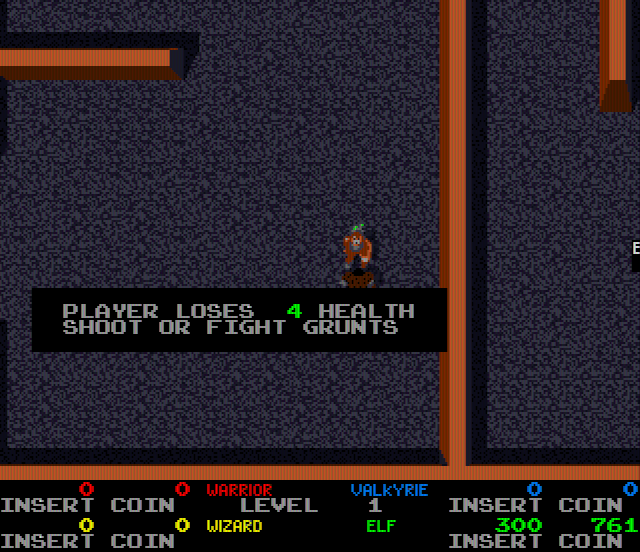

# Gauntlet (Atari Games, 1985) for the Atari STE

STEMultiGauntlet (named STEGauntlet until 2026-10-28): the arcade's Gauntlet on the STE, aimed at fast play and, later, networked play over the MIDI ports
(MIDI-Maze style: every player on a screen of their own).  Imported from STEArcade (commit 0ba04dc) on 2026-10-26.

2026-10-26 (STEMultiGauntlet): the picture uses the whole screen.  The borders are open at the top and the bottom
(stefastbobs2's screen, 276 lines): the maze over the full width, the arcade's x 0-319, in lines 0-239, hardware
scrolled as before; the side panel is gone from the picture and its cells (scores, health, inventory, names, level)
are laid out again in a status bar in lines 240-275 (`tools/bar.py`), a static image of its own that the Timer B
switches the display to (the video counter and the palette reloaded at its first line: `engine/rt/borders.s`
BD_HUD / BD_VSWITCH, PIC_TOP 0).  `-D SHOWFPS=1`: the picture rate of the last second in the bar's middle.  Objects and their shadows are drawn from
prepared streams per baked strip and shift (`MO_PREP`, each row only over its own words: the ghost horde 803k ->
658k cycles a picture, light play 4-14% less over 900 pictures; `docs/sprite-preparation.md`).  The game's own idea of the screen is widened to
match (`tools/patch.py` WIDE, 24 places): it kept players inside x < 216 of the old 224-pixel maze area, released
monsters beyond it, woke generators and aimed the magic only there, and centred the camera at x 104 with its right
limit for a non-wrapping maze at the old area's edge; now the bounds are 88 pixels wider, the camera centres the
players at x 148 (a player's 24 pixels in the middle of the 320) and stops with the right wall at the picture's edge.
2026-10-28: the players stay wholly inside the 320 x 240 picture.  The game's own window let a player (24 x 24) go
8 pixels past every edge (on the arcade under the side panel and the screen's edge; on the STE half a tile under the
status bar or off the top: measured, players pinned at y -8 and 224 when they spread apart).  The walking tests now
subtract 8 pixels more (two 12-byte routines in the program's zeros at $7F00, `jsr` in place of the `sub.w`) and
test 297 x 217 pixels: top left corner at x 0-296, y 0-216; the camera's box (every player inside, else it does not
move) is the same window.  Monsters, generators and the magic keep their windows.  Measured on the reference board
(seeds 3, 10, 12, 17 and two players walking apart): y 0-216, a lone player at (148, 108), centred.  The monsters
act (move, shoot, attack) only inside a window of their own, 15 pixels left of the screen and 256 pixels wide
($904A82, written at $46E7A; tested at $80E8, $84A0 and in 2-pixel units at $89F2): widened by the same 88
pixels, so monsters in the picture's right part no longer stand still.  `tools/logic_test.py` runs the original program
with the same patches (equal VBL for VBL, 8000 VBLs, seeds 3 and 12).  Transparent characters (the high-score and
"score per coin" pages are made of them) are kept in each ring between pictures: a row is copied back from P and
drawn again only when it changed, the ring moved, or something else wrote into its lines (`touch` notes the rows):
those pages 4.1M -> 72-104k cycles a picture, Hatari 1-2 -> 49-50 pictures a second.  Hatari
(attract mode's demo play): 27 pictures a second (2026-10-26, with the per-scene palettes: the tables 50, the title
23-50, demo play 13-45), 20 with a message box; a ghost horde now on screen (it was under
the panel) costs ~800k cycles a picture (was ~470k).

Hatari, 2026-10-28 (commit aaf0e7e: MO_PREP, DB15, checker dither; pinned build, 8 MHz STE, cycle-exact, fast-forward;
attract mode from boot, the program's `vbl_count` / `frames_done` / `pictures` read every 250 VBLs by debugger
breakpoints, 8,500 VBLs, two runs equal), pictures / logic ticks a second (the arcade's logic: 60):

| Scene | Pictures/s | Ticks/s |
|---|---:|---:|
| demo play, light (3 players, 1,000 VBLs) | 32.3 | 57.2 |
| demo play after the horde (1,250 VBLs) | 36.8 | 58.9 |
| demo play, ghost horde (1,250 VBLs) | 9.5 | 30.8 |
| the horde's worst 500 VBLs | 4.3 | 17.4 |
| demo play, all (3,500 VBLs) | 25.8 | 48.4 |
| legend / monster pages (4,500 VBLs) | 34.1 | 51.5 |

In the horde the renderer starves the logic (STARVE): the game itself runs at a third of the arcade's speed there.
Hatari's profiler over the horde (VBLs 2000-2750, CPU cycles with the Blitter's stalls, the runtime's symbols from
the link map), a picture: 939k (light play 219k): objects and shadows 343k (`mo_prep_draw` 155k, `mo_snapshot` 64k,
`mo_place` 34k), the game's program 206k (71k a tick, light play 14k), playfield / text / palette / bar 128k, pass
dispatch (`blit_go_split` ...) 87k, interrupts 78k, `render_frame` 63k.  `-D NOSHADOW=1` (measurement only: the
objects' shadow rows not drawn, pen 1 transparent) over the same game ticks: the horde 9.5 -> 12.3 pictures/s
(ticks 30.8 -> 34.5), 939k -> 779k a picture (`mo_prep_draw` 155k -> 76k), light play unchanged (32.3 -> 32.7);
the logic and the per-object work stay.

2026-10-28: **black shadows** (`MO_BLACKSH`, the default; `-D MO_BLACKSH=0`: the arcade's shadows).  An object's pen
1 (the board darkens the playfield under it: the objects' shadows and dark outlines) is baked into the object as an
opaque pixel of the scene's black: `pen_remap` gives every object palette's pen 1 RGB 0, `mo_bake` adds the shadow
mask to the opaque one, and no shadow rows are prepared or drawn.  The reference (`tools/video.py`
`Video.black_shadow`, set by `render_test.py` / `sprite_test.py` from the build's defines) draws pen 1 the same way;
both tests exact in both modes.  Hatari over the same game ticks: as fast as no shadows, the horde 9.5 -> 12.4
pictures/s (ticks 30.8 -> 34.4), light play 32.3 -> 32.7, demo play 25.8 -> 26.8 (`docs/black_shadow_horde.png`:
left the shadows, right black).  With it P' is no longer kept: a new tile goes into P only (`pf_tile_new`), and a
colour change of a shadow set (pens $200-$27F) neither redraws listed tiles nor counts as a colour change
(`set_changed`).  `render_test.py`, Musashi CPU + Blitter a picture (mean): attract mode 398.6k -> 374.2k (-6%),
seed 1 level 2 302.3k -> 299.1k, seed 12 level 5 265.1k -> 264.4k, seed 14 level 9 over 900 pictures 296.1k ->
291.7k with its maximum (a level start: the whole window's tiles) 4.22M -> 2.76M.  In Hatari the demo starts sooner
(115 ticks by VBL 750 against 61) and the rates per window stay within the runs' scatter (demo play 26.8 / 26.5).

2026-10-28: **the playfield tile cache** (`TCACHE`, with `MO_BLACKSH`: in P''s memory).  A camera cut (the demo's
jumps, a level start) draws ~650 new tiles in one picture, each ~3.5k cycles, most of it `tile_rows` (a byte of two
pixels at a time through the colour table).  `pf_tile_draw` now keeps every tile it draws, as P holds it (8 rows x 4
plane bytes, `movep`), in 2,048 direct-mapped slots (key: code, palette, flip x; and the palette's table epoch, which
`lut_build` counts, so a colour change makes them stale); a hit copies 8 rows instead.  Exact (`sprite_test.py`,
`render_test.py` four scenes; `-D MO_BLACKSH=0` unchanged).  `render_test.py` (mean / max a picture): attract
374.2k / 7.14M -> 359.7k / 5.41M, seed 14 level 9 291.7k / 2.76M -> 288.9k / 1.83M.  Hatari, the attract demo's
longest pictures: the camera cuts 20 -> 13 and 25 -> 18 VBLs; the dense horde's 12-20 VBL pictures stay (the game's
logic, ~129k cycles a tick there, and the objects).

2026-10-28: **a hit's flash no longer sticks.**  A player who is hit flashes: the game turns two pens of the
player's palette white for 2 frames (the elf: pens 11 and 12, its coat).  The objects' colours are checked every 4th
picture, and between large changes only pens not yet shown are taken (colour cycling left out); a large change that
came during the flash took the white, and the way back, a small change, was left out until the next large change:
the elf's coat stayed white for seconds (the attract mode, `render_test.py --seed 0`: 199 of the pictures sampled
every other frame from 2614 on).  Now, for `FRZ_SETTLE` (4) VBLs after a large change, every pen is taken again, and
a picture that took a light change checks again at the next picture (`mo_recheck`): the white goes at once (0
pictures).  The render harness counts a VBL a picture (`render_test.s`), as nothing calls `vbl_video` there.
Exact (`sprite_test.py`, `render_test.py` four scenes); the horde scene's cost unchanged (296.9k a picture).

2026-10-28: **one set of colours a page.**  The STE's hardware palette is DB15 + 1 throughout; what changed with the
arcade's colours was the mapping of its pens onto those 16, with freeze rules for colour cycling and fades.  Now the
colours are taken whole with a page or level and held until the next one (`pal_update` `.box`): a page coming back
from black stays black until its colours are still for `FADE_STILL` (8) VBLs (a fade-in left out: black, then the
whole page); a large change in play is taken once it stays (`PAGE_STILL`); between pages `pal_range_frz` takes only
pens not yet shown (no colour cycling, no flashes: a hit's 2-frame white flash is never taken); for `FRZ_SETTLE` (4)
VBLs after a page every pen is taken again (a flash caught at the take undone).  The playfield's red pulse (palette
10 = tile palette 2, pens 9-13, a pulse of 10 frames) is drawn in colour 15 (`PULSE_COL`, free in play: the title's
band uses it only while the panel is down), set every VBL from the average of the five pens (`pulse_col`).  The maze
tiles of levels 1-9 use only tile palettes 0, 1 and the exit (tile palette 2, pens 0 and 7), so neither the pulse nor
the grey ramps (palette 11) show there.  The game never reads its palette: none of this touches play.  Exact
(`sprite_test.py`, `render_test.py` five scenes); the horde scene 296.9k -> 285.6k cycles a picture (no redraws for
colour cycling).  The text's pens are taken every picture as before (their blinking).

### The ghost horde

2026-10-28, Hatari (the attract demo's densest horde, VBLs 2250-2750, the build with black shadows and the tile
cache; the profiler's CPU cycles include the Blitter's stalls; every picture's VBL and tick logged by a debugger
breakpoint on `pictures`): 70 pictures in 500 VBLs (7 a second, a new one every 9-13 VBLs, 3-5 game ticks apart:
the stutter), 1,145k cycles a picture:

| Part | a picture | |
|---|---:|---|
| the game's program | ~330k | 101k a tick, 3.3 ticks a picture |
| drawing the objects (`mo_prep_draw`, `mo_strip_draw`) | 162k | ~30 objects |
| the restores (`blit_go_split`: the Blitter's HOG pieces) | 86k | 285 pieces, ~69k of it Blitter time |
| the objects' list and records (`mo_snapshot`, `mo_place`, `mo_record`, `touch`, `mo_image`, `mo_object`) | 160k | |
| waiting for the flip (`render_frame` `.wait` on `frame_ready`) | 66k | the other ring still shown |
| bakes and prepared streams (`mo_bake`, `mo_prep`) | 36k | |
| interrupts and input (`timer_b`, `bd_ta_chain`, `jagpad_poll`) | 51k | `jagpad_poll` alone 16k |

The game's time is mostly its monster loop at $808E-$8412 (for each entry of the motion object list: its type, on
screen, then the four direction probes $8F38 / $9006 / $90D2 / $9192 against the maze, then its video RAM entry
written): ~58% of the 101k a tick.  The arcade's 68010 at 7.16 MHz has ~119k cycles a tick, so the board itself
slows down in such hordes.

`STARVE` (the VBLs without a picture before the game waits for the renderer; 4) does not help: 2 and 1 give
smaller steps (at most 4 and 3 ticks a picture against 6) but the game at 32% of its speed against 43%, and the
same long gaps (`-D STARVE=n`, the dense horde 9.9 / 9.9 / 10.9 pictures a second).

Not tried yet, in the order of their likely return:
* the monster loop and its probes rewritten (the same results, `tools/logic_test.py` VBL for VBL): it already runs
  natively, so only tighter code gains, ~745 cycles an object now, perhaps ~450: ~20k a tick, ~6% a picture;
* the restores per row of each object's own words (as its draw) instead of its whole rectangle;
* the objects' list and records (~100 objects a picture, ~150-250 cycles each in every one of `mo_snapshot`,
  `mo_place`, `mo_record`, `touch`, `mo_image`, `mo_object`: no single hot spot; a rewrite with the fields in
  registers might save 30-40k a picture).

Done: `jagpad_poll` (`engine/rt/jagpad.s`) first reads the four rows once and, with every line idle, clears `jp_in`
at once: the horde 16.0k -> 2.6k cycles a picture (the same 500 VBLs: 78 pictures and 243 ticks against 70 and 228,
partly the runs' scatter).  The flip wait is no use as it stands: the next picture's state exists only after the
VBL that ends it (the game's tick runs from there), and what does not depend on it (`pf_update` ~11k) is too little.



STE port of MAME set `gauntlet` (rev 14; driver `atari/gauntlet.cpp`).  Unlike the other ports nothing is translated:
the arcade's main CPU is a 68010, and its own program runs on the STE's 68000, patched in place.  The game's logic
runs at the arcade's speed (60 frames a second: six for every five VBLs), the picture 26 times a second in Hatari in
the attract mode's demo play, 32-37 in light play, 4-10 in a ghost horde (2026-10-28, table above); 320 of the 336 pixels and all 240 lines, the side panel as a status bar below, 16 colours; music, effects and
speech.  Needs a 4 MB STE and the whole machine: the program takes TOS's memory, so **Esc resets** the STE (there is
no return to the desktop and no CRASH.TXT; a crash turns the screen red and keeps its record at $3C1000).

```sh
python games/gauntlet/tools/prepare.py       # verify assets/gauntlet.zip, unpack to assets/extracted/gauntlet/
python games/gauntlet/ref/cover.py -1 420      # the coverage the patcher starts from: the BIOS's boot, then
for s in 0 1 2 3 4 11 12 13 14 15; do python games/gauntlet/ref/cover.py $s 15000; done   # attract, 1-4 players
python games/gauntlet/tools/build.py         # run/gauntlet/GAUNTLET.PRG (--sim: run/gauntlet_sim/ for the tests)
python games/gauntlet/tools/logic_test.py 8000 --seed 12 [--level 9]   # the patched program against the original
python games/gauntlet/tools/render_test.py --seed 1 [--level 7]   # the pictures against the reference renderer
python games/gauntlet/tools/sprite_test.py   # objects at every edge, 16 shifts, holes, shadows, 64 KB crossings
python games/gauntlet/tools/sound_test.py player|driver|mame|hatari   # the sound player against its model, the driver, MAME
python games/gauntlet/tools/sound_hle_test.py   # the sound board's model against the 6502 (the replies, the coins)
games/gauntlet/tools/shots.sh tap:5@20 down:x@22 up:x@24 shot@30   # its own Hatari: keys (scancodes), shots, dumps
python games/gauntlet/tools/mame_roms.py     # build/gauntlet/mame_roms/: the set as MAME 0.289 wants it (-rompath)
python games/gauntlet/ref/mame_cmp_gauntlet.py [frame ...] [--keep DIR]   # the reference board against MAME 0.289
python games/gauntlet/ref/trace_cmp.py main|sound F0 F1 [--keep DIR]   # one CPU against MAME's trace
```

Supply `assets/gauntlet.zip`: the 20 files of MAME's `gauntlet` under MAME's names (`docs/rom_manifest.json`
has their sizes, CRCs and SHA-1s).  All match MAME 0.289 but `136037-104.6p`, the alphanumerics: the archive has the
8 KB dump of the 27128, MAME lists the whole chip (16 KB, the second half $00, crc32 6c276a1d), so
`tools/mame_roms.py` writes MAME a copy padded with zeros.  Nothing ROM-derived is in git: the patched program, the
boot state, the graphics and the sound data are made in `build/gauntlet/`.

Controls: **5 / 6 / 7 / 8** coin 1-4 (players 1-4), **arrows** move, **Space / Control / Z** fire, **Alternate / X**
magic, which also **starts** (after a coin), **Esc** resets the STE.  Joystick 1 player 1, joystick 0 player 2.
Jaguar pad / PowerPad: pad A player 1, pad B player 2, **A** fire, **B / C** magic, **Option** coin.

## The port

### The program (`tools/patch.py`, `tools/boot.py`, `src/gauntlet.s`)

* **The ROM where it was**: the patched program (`build/gauntlet/program_ste.bin`) is copied to $000008-$04FFFF, its
  arcade addresses, so no code address, jump table or return address changes.  What the STE has no memory for moves
  below 4 MB, with only the high byte changed ($90xxxx -> $3Fxxxx video RAM, $91 -> $3E palette, $80 -> $3D work RAM,
  EEPROM and I/O, $93 -> $3C x scroll): the game keeps the low words of pointers and builds them again (the EEPROM's
  offset from A1's low word), keeps flags in their top byte ($01904DD4) and adds to them ($984DCA, a mirror).  The
  patcher rewrites every absolute operand and long immediate that names those areas in the code (the coverage's
  instructions and recursive descent from them: 1,904 places), the long words of a few data tables ($D800, $9DE6, the
  BIOS's tables), and not two `movea.l #$800002` that are packed constants.  The few I/O sites become calls of the
  runtime (the sound command, the sound CPU's reset bit) or plain RAM (inputs, status, watchdog, IRQ acknowledge);
  the slapstic's bank switch routines become calls that copy the selected 8 KB bank into the window $38000-$3FFFF
  (rare: a few dozen times in 15,000 frames).  The descent follows the program's jump tables (`move.w (d8,pc,dn.w),dn;
  jmp (2,pc,dn.w)`: 7 of them, their cases 88 window addresses the coverage had not reached; level 12 ended in a bus
  error before).  An address the patcher missed is above 4 MB on the STE: a bus error,
  never a silent wrong access.  The runtime is linked at $50000, behind the program (`src/loader.s` moves it there
  out of the .PRG); the MFP's vectors are at $280 ($100-$27F is the BIOS's jump table the game calls).
* **The writers' marks**: the playfield's writers (three routines writing a maze cell's 2 x 2 tiles, the clear
  routine) call runtime stubs (`SITES` pf_blk_*, mem_clear) that mark the quarter columns (16 tile rows) they write;
  the alphanumerics' 17 writing routines (the BIOS's text, the panel, the high-score entry; logged on the reference
  board) each have one instruction replaced by a call of a generated hook (`HOOKS`, build/gauntlet/hooks.i: the
  mark, the instruction's own bytes, rts).  The renderer compares only what was marked (the playfield: the window's
  quarters of a marked column), and one playfield column and one alphanumerics row a picture in turn, so a writer
  the lists miss would show within about a second, not never.  `tools/logic_test.py` checks that every change was
  marked by the time the game waits.
* **The boot**: the STE starts where the BIOS hands the game over (`jmp $40000`, frame 378: the self-tests, whose ROM
  checksums would fail on the patched image, and six seconds of waiting are behind it), from the state the reference
  board has there (`tools/boot.py`: memory, registers, slapstic bank; the BIOS's own pointers relocated).
* **The schedule**: two threads.  The picture is the foreground; at each VBL the runtime delivers the game's IRQ 4 (its
  handler at $34A) and switches to the game's own thread, which runs until it waits for the next frame: its two wait
  loops are TRAPs (#14 at $40C28 in the main loop, #13 at $40F88), which switch back.  A VBL that comes while the
  game still runs only delivers the IRQ 4, as the arcade does.  The arcade's 60 Hz: every fifth VBL a sixth IRQ 4 is
  due, given when the game next waits at TRAP #14 (its next frame then follows at once; the main loop takes one frame
  per IRQ 4 while it waits and loses one that comes while it runs, as on the arcade; `-D TICK50`: one a VBL).  The VBL's own work (the picture's flip, the inputs,
  the sound) runs on its own stack: the game's lives among its variables in the video RAM.
* **The sound board** (`src/sound.s`, `tools/sound_hle.py`): the 6502 does not run.  The main CPU only needs four
  replies: the coin counts ($03, 2-bit counters per slot, one count a key press), the sound watchdog's ping ($07: 0),
  a service query ($06) and $FF after a sound reset.  They come as the game's IRQ 6 when its frame is done or at the
  VBL (a reply at once would miss the BIOS's block pointer, which it sets after the write: credits doubled).
  `tools/sound_hle_test.py` checks the protocol against the 6502 on the reference board.
* **Checked** (`tools/stemodel.py`, `tools/logic_test.py`): the original program (arcade map, the real slapstic) and
  the patched one (the STE's map) run on the STE's schedule on two instances of the 68010 core, VBL for VBL (a VBL
  after a fixed number of the program's instructions, not counting the patched sites): the video RAM, palette, work
  RAM, EEPROM and the sound commands equal (a pointer and its STE form count as equal; the dead stack below SP is
  left out), and every change of the playfield and the alphanumerics marked (above).  Attract mode and random plays
  of 1-4 players, 8,000-15,000 VBLs each, and in levels 3-30 (`--level`).  The coverage
  (`ref/cover.py`) runs on the same schedule, plus the BIOS's boot on the reference board.
* **Speed** (Hatari, 2026-10-26, a scripted game in level 1 and the attract mode): the game's 60 frames a second
  (98-100%); in play its logic needs ~25-50% of a VBL.  Pictures: attract 16.0 a second, play 32.6 (before: one
  frame a VBL, 15.8 and 23.4).

### The picture (`src/render.s`, `tools/assets.py`)

320 x 276 with the top and bottom borders open: the maze (playfield, objects, the alphanumerics' messages) is the
arcade's x 0-319 at the STE's 0-319 in lines 0-239; the status bar (the side panel's cells: `tools/bar.py`) in lines
240-275 from its own image (BIMG).  While the panel is up (its characters all opaque) the alphanumerics right of the
maze (columns 29-39) go to the bar only; else (the title, the high scores, the monster pages' text) they are drawn
over the playfield and the bar is empty.

* **Playfield**: the 512 x 512 torus kept as a bitmap in STE planes, P, and P' in the shadow colours (pens $200-$27F;
  only with `-D MO_BLACKSH=0`); a tile is drawn into both when the game changes it in the visible window (compared with a copy where the game's
  writers marked it) or when its colours map to other STE colours.  Two display rings of 56 words x 880 lines, drawn in turn, shown with
  the hardware scroll (base address, $ffff8265, $ffff820f); every ring position shows a fixed place of the torus, so
  moving the window copies only the strip a ring has never held, and a ring copies from P only the damage (objects,
  characters, the panel's old place).
* **Alphanumerics**: drawn per changed character into a 320 x 240 image; runs of opaque characters (a message box is one
  rectangle) are copied into the ring with the Blitter at the fine scroll, kept when the ring's place and the
  characters are unchanged; transparent characters by the CPU through their pixel masks.
* **Motion objects**: as MAME, each band of 8 lines from its SLIP entry along the links; an object is drawn whole
  when every band it covers lists it.  Drawn whole into the hidden margin left of the window, the ring right of it and
  the guard lines.  Baked on first use per (code, size, flip, palette, the palette's colour
  mapping) into a 400 KB pool as 32-pixel strips; a row is one HOG pass (Y count 4, the opaque mask in END1-END3,
  the END registers written only when the mask changes, the source address running on).  Shadow pixels (pen 1: the
  playfield's colour with bit 7 flipped) are a pass per row from P' at the same place, so they are exact.  The
  reordered-source variant (`-D MO_ORDER=1`) measured slower (`docs/sprite-preparation.md`).
* **Status bar** (`tools/bar.py`, render.s bar_update): per cell the panel's word and the bar's byte; a cell is
  drawn again when its word or its colour's pens change.  Two bands: players 1 | 2 over 3 | 4, each player's values
  and inventory rows whole at the bar's edges, the names next to them, "LEVEL n" in the middle.
* **Colours**: per-scene palettes of 16 (`ref/scene_palettes.py`, `docs/scenes.json`, compared with the arcade and
  DawnBringer 16 in `docs/palette_compare.png`): the attract mode and play sampled, object pixels weighted x8, ten
  palettes fitted in Oklab per kind: seven for pictures with the side panel up (play: black plus 15) and three for
  it down (the title, the tables: black plus 14, colour 15 left for the title logo's band).  `scene_check` scores the visible tiles, characters and objects against every palette of
  the picture's kind and changes palette only after a large colour change, a quiet spell and two checks agreeing,
  then holds it for 256 pictures.  Every IRGB word maps to its nearest colour of the current palette; when a pen's
  colour changes, what uses it is drawn again.  Colour cycling is left out: small changes are taken only for dark
  pens, object colours every 4th picture (heavy changes every 32nd), and while the panel is down the objects' colours
  are taken once, when they have been still for 16 pictures, and held until the panel comes up.  The arcade's
  blackouts between pages (every pen but a few unused ones black for 2-30 frames) are one step each way: the
  picture goes black at once with its colours kept, and when the palette comes back every pen is taken in that
  picture and the new page's palette chosen at once (no staged darkening).  A blackout of 2 frames can fall between
  two pictures, so with the panel down any large change is taken the same way (a new page); in play a large change
  freezes the colours until it has stayed 2 pictures, then is taken whole (no staged fade-in, a short flash left
  out).  When the panel goes up or down the palette of the other kind is chosen in that picture (`view_check`).
* **Palette (the default since 2026-10-26)**: `docs/palette_db15.json`, DawnBringer 16 on the STE grid without its
  brown (15 colours, colour 0 the near-black $112) plus colour 15 kept free (the title logo's band; a colour-cycled
  glow later).  Since 2026-10-28 its cyan (the rarest colour in play) is a neutral dark grey #333344: the floor's
  dark greys had only #111122 and #554455, a checker of the two between them (twice the arcade's contrast, a rough,
  dark floor); now its middle greys take the new grey.  Chosen by eye over the fitted palettes above: more shades in the sprites, every player and monster
  recognisable.  `tools/assets.py` gives every scene this palette (the scene machinery stays, its choice no longer
  matters), mapped in Oklab with the lightness scaled by 0.5; the status bar keeps its own palette.
  `GAUNTLET_PALETTE=scenes python games/gauntlet/tools/build.py`: the fitted scene palettes again.
* **Checker dither** (the maze and the objects, not the text): a pen may show as a checker of two palette colours
  (`tools/assets.py` checker_pairs: the pair whose mix in linear light, as a CRT blends neighbouring pixels, matches
  its colour best, the pair's own contrast x 0.25 added so that only close colours mix; `GAUNTLET_DITHER=0` turns it
  off, a smaller weight mixes more).  render.s keeps each pen's pair (pen_pab: a << 4 | b; the text's a == b) and a
  second set of colour tables (LUTB) for the odd rows: the maze's tiles take the checker from the maze's coordinates
  (it scrolls with the maze), a baked object from its own top left corner (it moves with the object); no cost at
  draw time.  The reference renderer's phase_map gives the same phase, so the tests stay exact.
* **The title logo's colour band** (the arcade's raster effect: the logo has a pen a line, lines 162-218, and the
  game moves a gradient through those pens): on the STE the band pens are colour 15 while the title is up, and the
  Timer B rewrites colour 15 at every line end of the band (`engine/rt/borders.s` BD_BAND: an early, polled event
  for its first line, then a chain of 16-byte handlers with the colours as immediates), from the arcade's own band
  colours, converted every VBL (render.s band_build); no band on a blacked-out picture.  The handlers are installed
  in the Timer B's own vector (BD_TB_VEC: $2A0 here, where gauntlet.s moves the MFP's vectors).  A HOG Blitter pass
  may hold a line's handler back, its colour then up to half a line late.  The status bar has its own fixed
  palette of the panel's colours (`bar_cols`, loaded by the Timer B at line 240).
* **Centring**: while the panel is down the picture shows the arcade's x 8-327 (the title and tables centred on its
  336 pixels); in play x 0-319 (`view_check`).
* Every Blitter pass is HOG and at most 256 bus cycles (`BLIT_STATS=256`).
* **Tests**: `tools/render_test.py`: the STE picture equals the reference picture through the palette, pixel for
  pixel (attract mode, play in any level with `--level`, consecutive pictures in both rings: 4,950 pictures, 0
  differ); `tools/sprite_test.py`: objects at every edge, all 16 shifts, both flips, 1-8 tiles wide, holes and
  shadows, priority, partial band lists, the transparent panel, 64 KB crossings (305 pictures, 0 differ).
* **Scheduling**: when the renderer has made no picture for 4 VBLs, the game waits a VBL at its next frame start so
  the picture catches up (`gauntlet.s`, STARVE).  (Pausing the game's thread in the middle of a frame was taken out:
  it crashed on the STE.)  Sound replies waiting are delivered as IRQ 6 at every VBL, also one that comes while the
  game's frame still runs: held back through a long boot frame, a reply arrived after the BIOS's watchdog had reset
  the sound CPU, every later reply answered the command before it, and the reset's $FF was read as the coin byte
  (credits for all four players).  Test switches: `-D NOKBD` (keys ignored, for unattended Hatari runs), `-D NOBAND`,
  `-D STARVE=n`.
* **Speed** (Musashi, CPU + Blitter): 115k-390k cycles a picture in play (median by scenario), about 10-12k an
  object with its restore; the attract mode's title (about 260 fading objects, baked again each picture) is the
  slowest.  The writers' marks (2026-10-26; `render_test.py --first 1300 --frames 1600 --every 1`, 300 pictures):
  level 5 with three players 230.2k -> 189.8k a picture (median 208.8k -> 167.3k), level 2 with one 179.2k ->
  138.1k (median 157.2k -> 115.6k); the comparisons 52k -> 16k.  Per picture in level 5 now: object rows 32k, the
  object list 29k, shadow rows 27k, baking 18k, Blitter copies (restores, the panel) 18k, comparisons 16k.

### The sound (`tools/sound.py`, `src/sound_out.s`, `tools/sound_test.py`)

The 6502's driver modelled at the level of its voices: 12 logical channels (POKEY 0-3, YM2151 4-11), 30 voices; a
sound starts one voice per channel of its chain (the driver's tables $5F36 / $63E2, channel $6166, priority $5FBE), a
voice of equal priority replaces the old one, lower ones keep running underneath.  $01 / $02 set the floor (the
attract mode sends $01: only the title music $42 and priority-63 sounds there); speech has an 8-deep queue by
priority and lowers the YM / POKEY gains while it speaks (the STE also cuts the YM by 6 volume steps and the POKEY's
voices by 4 while a phrase speaks: its DMA speech is at full scale, yet the YM2149 played 18.4 dB (POKEY 11.7 dB)
louder against it than MAME's mix; the "welcome" was buried under the effect $09 sent with it, 13% of the mix's
power speech, now 68%, the arcade's 86%); $DD-$E0 the mixer, $43 / $48 fades.

* **Recordings**: each sound alone on the reference board at 50 Hz (the music keeps its tempo at the STE's speed).
  POKEY channels become tone or noise; YM2151 loudness from the carriers' envelopes, the timbre from rendering all
  four operators and matching the spectrum to a square wave, YM noise or both (many effects are feedback-7 FM
  noise); voice lifetimes from the driver's lists plus the chip's release; loops where the driver's voice tables
  repeat.  On the YM2149 the 3 loudest of the 12 channels each tick.
* **Speech**: 141 phrases synthesized with MAME's TMS5220 lattice filter (0.998 against MAME's waveform), at 6258 Hz
  as 4-bit ADPCM (428 KB for 137 s; 8-bit PCM would need 857 KB), decoded 64 bytes a VBL into a buffer the DMA sound
  plays once.
* Memory ~520 KB in all; `snd_out_vbl` (on its own stack) ~1,600 cycles a VBL, 12k at the 99th percentile.
* **Tests**: the 68000 player against its Python model, every tick (72,802 ticks, 0 differ); the model against the
  real driver per channel and tick (4-9% of the sounding channel-ticks differ: a retrigger carries the FM envelope
  over, sub-tick timing); pitches against MAME's audio (the right pitch wins for every piece); a Hatari recording.

## The reference board

* **Main**: MC68010 at 14.318181 MHz / 2.  `engine/m68kmame.py` is MAME's own Musashi: the build takes MAME 0.289's
  core sources (`m68k_in.lst` through MAME's `m68kmake.py`, the functions of `m68kcpu.cpp` a 68010 needs, unchanged;
  downloaded from github.com/mamedev/mame, tag mame0289, into `build/mame0289/`) and compiles them outside MAME with
  a stand-in for MAME's framework (`engine/m68kmame/emu.h`) and a C interface (`glue.cpp`: 4 KB pages of RAM / ROM /
  unmapped / callback with mirrors, the board's callbacks through ctypes, an instruction hook, a trace buffer,
  coverage per instruction).  The copy of MAME in F030Arcade is 0.286 with local changes and its 68010 differs (0.289
  counts no per-bit shift cycles below the 68030).
* **Slapstic** 137412-104 (`mame/atari/slapstic.cpp`): MAME taps the whole program space, so every bus access of
  the 68010, opcode and immediate fetches included, is tested (a read after the access, a write before).  The state
  machine runs in `glue.cpp` on the tests `tools/machine.py` builds (MAME's checker); a bank change points the
  window's pages ($38000-$3FFFF, the 8 KB bank four times, and its mirrors) at that bank's copy.
* **Sound**: MOS 6502 at 14.318181 MHz / 8, `engine/m6502mame.py` (generated from MAME's `om6502.lst` by
  `engine/m6502mame_gen.py`: every bus access on MAME's cycle, dummy reads and writes too, resumable inside an
  instruction at a slice's end).  YM2151 (timers and status: `engine/m72board.py`'s model; its IRQ is not
  connected), POKEY (`engine/pokey.py`: an execute device of its own in MAME, run after the 6502; a read or write
  is a synchronize()), TMS5220C (`engine/tms5220.py`: the FIFO, the frame parsing, the ready line; its stream is
  rendered at the CPU's reads and writes, its io_ready timer and the 50 Hz sound update).  The audio itself is not
  made.  Both latches are MAME's generic_latch_8 (a write lands through a synchronize() timer); a sound command
  raises the 6502's NMI and a perfect quantum (the second smallest CPU minimum, 0.56 us) for 100 us.
* **Interrupts**: IRQ 4 at the vertical blank's start (acknowledged by a write to $803140), IRQ 6 while a sound
  response is pending; the 6502's IRQ from the scanline timer on lines 32, 96, 160 and 224.
* **Scheduler** (`tools/machine.py`): MAME's timeslice() in integer attoseconds, the default quantum (1/60 s), the
  three executing devices in device order (maincpu, audiocpu, pokey), the screen's timers (vertical blank begin and
  end, line 0), the scanline timer, the sound manager's 50 Hz update.

Memory (main CPU): ROM $000000-$00FFFF and $040000-$04FFFF (the "BIOS" and the game; the interrupt vectors jump
through $40000), the slapstic window $38000-$3FFFF, work RAM $800000 (unused in the attract mode: the program's
variables and stack are in the spare video RAM at $904000), the EEPROM $802000, I/O $803000, video RAM $900000
(playfield, motion objects, spare, alphanumerics, y scroll at $905F6E, SLIPs), palette $910000, x scroll $930000.

Video (`tools/video.py`, gauntlet.cpp + atarimo.cpp): the playfield 64 x 64 tiles of 8x8 (512 x 512, scrolled), the
motion objects (linked lists through the SLIP table, 8-line bands; pen 1 is a shadow: it flips the playfield
colour's bit $80; the port draws it black by default, `MO_BLACKSH`), the alphanumerics 64 x 31 on top; 1024 pens IRGB_4444; 336 x 240 visible at 59.92 Hz.

### Checked against MAME (`tools/machine.py`, `ref/mame_cmp_gauntlet.py`, `ref/trace_cmp.py`)

* **Both CPUs exact** against MAME's debugger trace (address, cycle count; the 6502 also its registers): the main
  CPU frames 0-3, 380-420 and 9000-9010 (about 660,000 instructions), the sound CPU frames 370-400, 600-800 and
  9000-9100 (2.9 million, from its release from reset).
* **Memory and pictures**: `ref/mame_cmp_gauntlet.py` from power-on at 43 frames through 19801 (two loops of the
  attract mode: the demo play in the mazes, the monster pages, the high scores, the title): work RAM, video RAM,
  palette, the sound CPU's RAM, the x scroll and every sound command equal; the reference renderer on MAME's memory
  and the board's own picture both 0 differing pixels and 0 differing pens.
* `engine/m6502mame_test.py`, `engine/pokey_test.py`, `engine/tms5220_test.py`: the cores and chips against logs
  of MAME's gauntlet (every bus access of 613,395 sound CPU instructions, every opcode, all decimal ADC / SBC; 2.3
  million TMS5220 accesses with 15 internal fields; 116,000 POKEY accesses with its counters and polynomials).
* Speed: about 6 ms an arcade frame without the sound CPU's devices, 13 ms with them (the 68010 runs native).
* Not checked yet: play (coins, start, the levels) against MAME; the EEPROM's writes (the high-score table) beyond
  the attract mode.

## Full-game verification status

Automated players such as Dreamer can attempt a full playthrough once this port's
adapter and native Hatari replay transport are verified. An attempt or assisted
stage visit does not establish completion; a successful natural Hatari playthrough
and graphics, sound and control checks are required for green **Complete** status.
See the shared [status and verification policy](../../docs/port-status.md) and
[current port status](../../README.md). Existing test results above retain their
stated scope; this note does not claim a new successful run or Dreamer integration.
